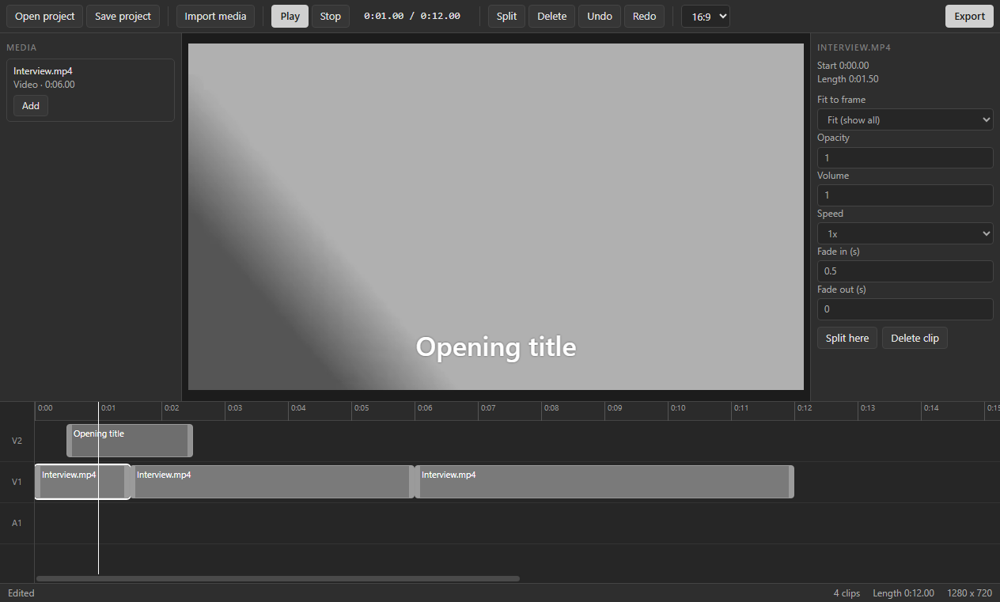

# Cutout

A private video editor for Windows. Put clips on a timeline, trim and split them, add titles, music and fades, then export to MP4, WebM or GIF. No account, no subscription, no watermark and no internet connection needed.

## What you can do

- **Multi-track timeline** with two picture tracks and a sound track
- **Trim, split, move and delete** clips, with snapping to neighbours and the playhead
- **Add titles** with size, position and colour
- **Fade in and out**, change volume, speed (0.5x to 2x) and opacity
- **Mix pictures over video** on the upper track
- **Pick the frame shape**: 16:9, 9:16, 1:1 or 4:3
- **Preview instantly** while you edit, with undo and redo
- **Save your project** and open it again later
- **Export** MP4 (H.264), WebM (VP9) or an animated GIF at 480p, 720p or 1080p
- Works with MP4, MKV, MOV, WebM, AVI, MP3, WAV, FLAC, M4A, PNG, JPG and more

## Your files stay on your computer

Cutout works entirely offline. There is no account, no upload and no tracking. Your original files are never changed.

## Download

Get **Cutout-Setup-1.0.0.exe** from the [Releases](../../releases/latest) page and run it.

Part of the [Lookout](https://github.com/plawanpawin-byte/Lookout) family of apps.

Released under the MIT License. Media processing uses FFmpeg, which is licensed under the GNU GPL.
