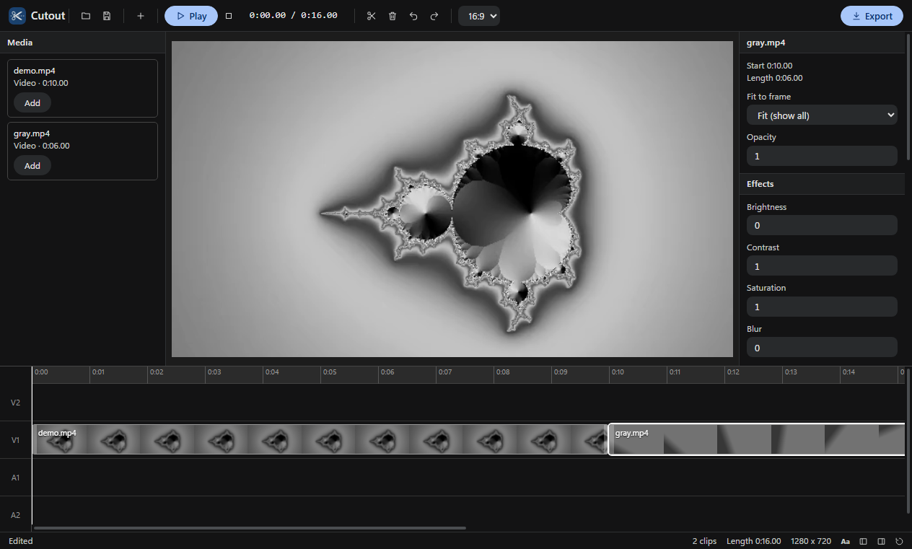
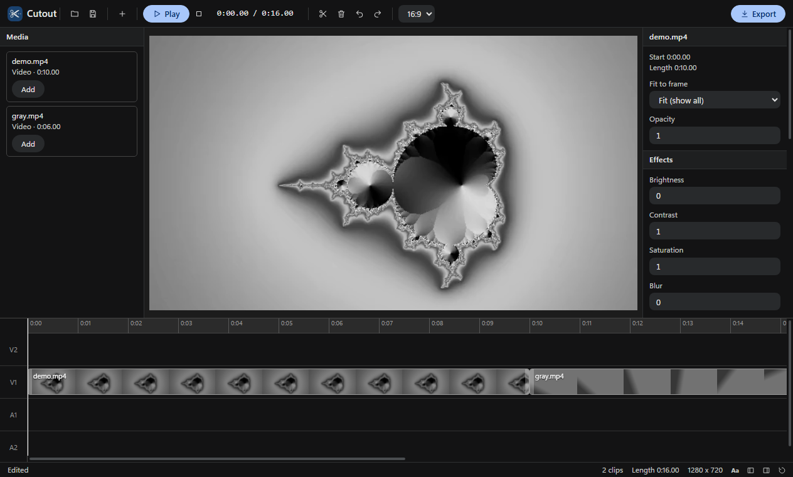
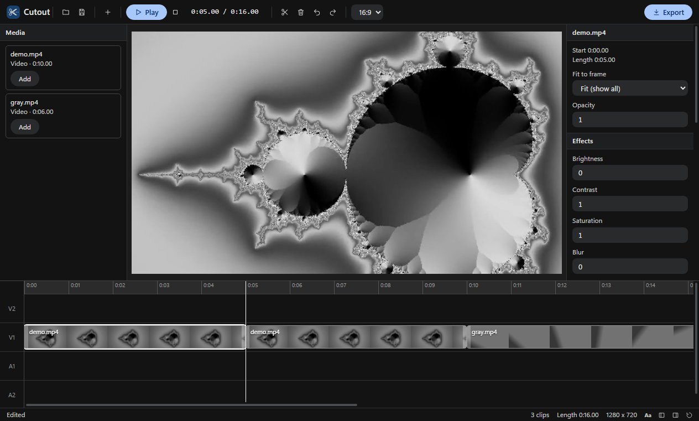
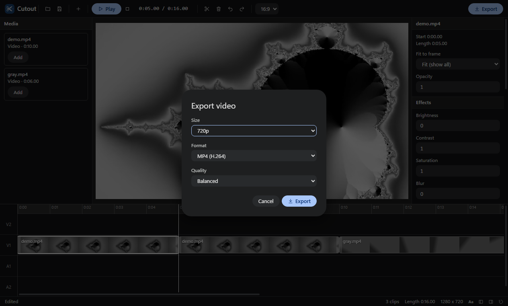
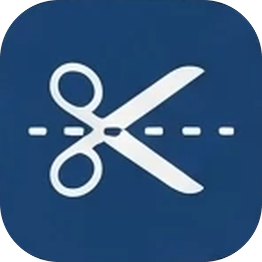

<h1 align="center">Cutout</h1>

<b>Video editing on a timeline</b> Version 1.0.14 for Windows · Free · Offline · No account

<a href="https://github.com/plawanpawin-byte/cutout/releases/latest"><b>Download Cutout</b></a> · <a href="https://github.com/plawanpawin-byte/lookout-launcher">Lookout launcher</a> · <a href="https://github.com/plawanpawin-byte/Lookout">All Lookout apps</a>

---

Cutout is a video editor with a multi-track timeline. Import clips, place them in order, split and trim them, add titles and fades, set the volume and speed of each clip, preview the result and export a finished video. It ships with its own copy of FFmpeg, so nothing else needs to be installed.

**Made for:** Anyone who wants to cut together holiday clips, tutorials, screen recordings or short social videos without a subscription or a watermark.

**On this page:** [In plain words](#in-plain-words) · [Who it is for](#who-it-is-for) · [Try it in 3 steps](#try-it-in-3-steps) · [Screenshots](#see-it-in-action) · [Features](#everything-it-can-do) · [How to use it](#how-to-use-it) · [Privacy](#private-by-design) · [Install](#install) · [Questions](#questions)

## In plain words

Cutout is a **video editor**. You bring in video clips, photos and music, place them one after another on a **timeline** (a strip that represents time, with rows called tracks), and cut them to the length you want. You can split a clip in two, delete the part you do not want, add titles, fade in and out, change the volume or speed of each clip, and play the result before you save.

When you are done, **Export** writes a finished video file. Cutout includes its own copy of the video tool FFmpeg, so there is nothing else to install.

**Not for:** Cutout is for straightforward editing. It is not a professional colour-grading or special-effects studio.

## Who it is for

- **Families** trimming holiday clips into one short film.
- **Creators** making short videos with titles and music.
- **Teachers** cutting a lesson recording down to the useful part.

## Try it in 3 steps

1. Click **Open** and add two clips from the media list on the left.
2. Move the playhead and press the scissors to split a clip, then delete the bit you do not need.
3. Press **Export** and choose the quality.

## What is new in 1.0.14

A new look inspired by Google's own tools (AI Studio, Colab, Gemini): a calm dark charcoal theme, rounded pill buttons, a soft blue accent and roomier spacing. The app icon is now a colour logo so you can find Cutout at a glance in the Start menu and in the Lookout launcher. All screenshots below were taken again with the new look.

## In plain words

Cutout is a **video editor**. You bring in video clips, photos and music, place them one after another on a **timeline** (a strip that represents time, with rows called tracks), and cut them to the length you want. You can split a clip in two, delete the part you do not want, add titles, fade in and out, change the volume or speed of each clip, and play the result before you save.

When you are done, **Export** writes a finished video file. Cutout includes its own copy of the video tool FFmpeg, so there is nothing else to install.

**Not for:** Cutout is for straightforward editing. It is not a professional colour-grading or special-effects studio.

## Who it is for

- **Families** trimming holiday clips into one short film.
- **Creators** making short videos with titles and music.
- **Teachers** cutting a lesson recording down to the useful part.

## Try it in 3 steps

1. Click **Open** and add two clips from the media list on the left.
2. Move the playhead and press the scissors to split a clip, then delete the bit you do not need.
3. Press **Export** and choose the quality.

## See it in action

### Clips on the timeline

Two clips side by side on video track 1. The preview shows the frame under the playhead.

### Clip properties

Select a clip to set how it fits the frame, its opacity, volume, speed and fades.

### Splitting a clip

Press S or Split to cut a clip at the playhead, then trim or delete either half.

### Export options

Pick a size, a format and a quality level before rendering.

### What you get out

A frame taken from the exported video file.

## The interface

- **Top bar:** open and save projects, import media, play and stop, the time readout, split, delete, undo and redo, aspect ratio, and Export.
- **Left panel:** your imported media, each with an Add button. **Centre:** the preview. **Right panel:** settings of the selected clip.
- **Timeline (bottom):** two video tracks and an audio track with a time ruler and a playhead.

## Everything it can do

### Timeline

- Two video tracks and one audio track
- Drag to move clips, drag their edges to trim
- Split at the playhead, delete, close gaps
- Zoom the timeline with Ctrl + wheel

### Clip controls

- Fit or fill the frame
- Opacity, volume and playback speed
- Fade in and fade out

### Titles

- Add title text over the picture

### Projects

- Save and reopen .cutout projects
- Locate missing files if you moved your media

### Export

- 480p, 720p or 1080p
- MP4 (H.264), WebM (VP9) or GIF
- Small file, balanced or high quality
- Aspect ratio presets such as 16:9

## How to use it

1. Click **Import media** and choose your clips.
2. Click **Add** on a clip to put it on the timeline.
3. Move the playhead and press **S** to split. Drag clip edges to trim.
4. Select a clip to adjust volume, speed and fades.
5. Click **Export**, choose a size and quality, and pick where to save.

## Keyboard shortcuts

| Keys | What it does |
| --- | --- |
| Space | Play or pause |
| S | Split at the playhead |
| Left / Right arrow | Step the playhead |
| Home / End | Jump to the start / end |
| Delete | Remove the selected clip |
| Ctrl + Z / Y | Undo / redo |
| Ctrl + mouse wheel | Zoom the timeline |

## Files and formats

Imports common video, audio and image files. Exports MP4, WebM and GIF. Projects are .cutout files.

## Private by design

- No account, no sign-in, no subscription, no ads.
- Cutout works offline. It never uses the network.
- Files are opened and saved only through the Windows file dialogs you use. Cutout cannot browse your disk on its own.
- The app window runs in a locked-down sandbox with a strict content policy.

## Install

1. Open the [latest release](https://github.com/plawanpawin-byte/cutout/releases/latest) and download the file named **Cutout-Setup-** followed by the version number and **.exe**. You can also install it from the [Lookout launcher](https://github.com/plawanpawin-byte/lookout-launcher), which keeps it up to date.
2. Run the installer. It installs just for you, so it does not ask for administrator rights.
3. Windows may show a blue **Windows protected your PC** screen because these installers are not signed with a paid certificate. Click **More info**, then **Run anyway**.
4. Open Cutout from the Start menu.

**Requirements:** Windows 10 or 11, 64-bit. About 500 MB of free disk space. No internet connection is needed to use the app.

## Questions

**Is it fast?**  
Editing is instant. Export speed depends on your processor because encoding happens on your computer.

**Does it add a watermark?**  
Never.

**Does it change my original clips?**  
No. Your files are only read; the edit lives in the project and the export is a new file.

**What if the export is slow?**  
Long or high-resolution videos take time because the computer has to re-encode them. Use a smaller size to speed it up.

**Can I save my work and come back?**  
Yes. Save the project and open it again later.

**Does it change my original clips?**  
No. Your files are only read; the edit lives in the project and the export is a new file.

**What if the export is slow?**  
Long or high-resolution videos take time because the computer has to re-encode them. Use a smaller size to speed it up.

**Can I save my work and come back?**  
Yes. Save the project and open it again later.

## About Lookout

Cutout is part of **[Lookout](https://github.com/plawanpawin-byte/Lookout)**: ten small, private Windows apps for documents and media that share one look and one promise, that your files stay on your computer. Install and update them together with the [Lookout launcher](https://github.com/plawanpawin-byte/lookout-launcher).

| | App | What it is for | Code |
| --- | --- | --- | --- |
|  | **Lookout** | Install, open and update all the apps below | [GitHub](https://github.com/plawanpawin-byte/lookout-launcher) |
|  | **Pageout** | Read, annotate and sign PDFs | [GitHub](https://github.com/plawanpawin-byte/pageout) |
|  | **Chartout** | Flowcharts, org charts and diagrams | [GitHub](https://github.com/plawanpawin-byte/chartout) |
|  | **Branchout** | Mind maps and outlines | [GitHub](https://github.com/plawanpawin-byte/branchout) |
|  | **Planout** | Project plans and Gantt timelines | [GitHub](https://github.com/plawanpawin-byte/planout) |
|  | **Frameout** | App and web screen design with click-through prototypes | [GitHub](https://github.com/plawanpawin-byte/frameout) |
|  | **Cutout** | Video editing on a timeline | [GitHub](https://github.com/plawanpawin-byte/cutout) |
|  | **Shiftout** | Convert and compress video and audio, make GIFs | [GitHub](https://github.com/plawanpawin-byte/shiftout) |
|  | **Castout** | Record your screen | [GitHub](https://github.com/plawanpawin-byte/castout) |
|  | **Mendout** | Check and repair damaged video, audio, pictures and PDFs | [GitHub](https://github.com/plawanpawin-byte/mendout) |
|  | **Tuneout** | Record and edit audio | [GitHub](https://github.com/plawanpawin-byte/tuneout) |

Released under the MIT License.
